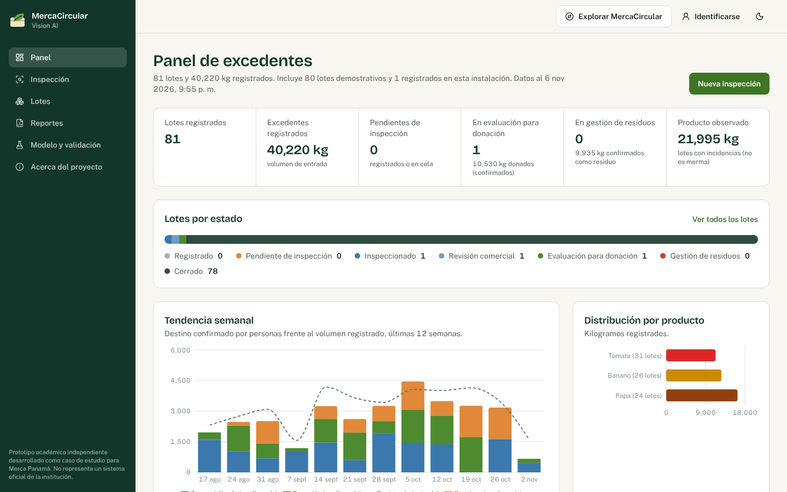
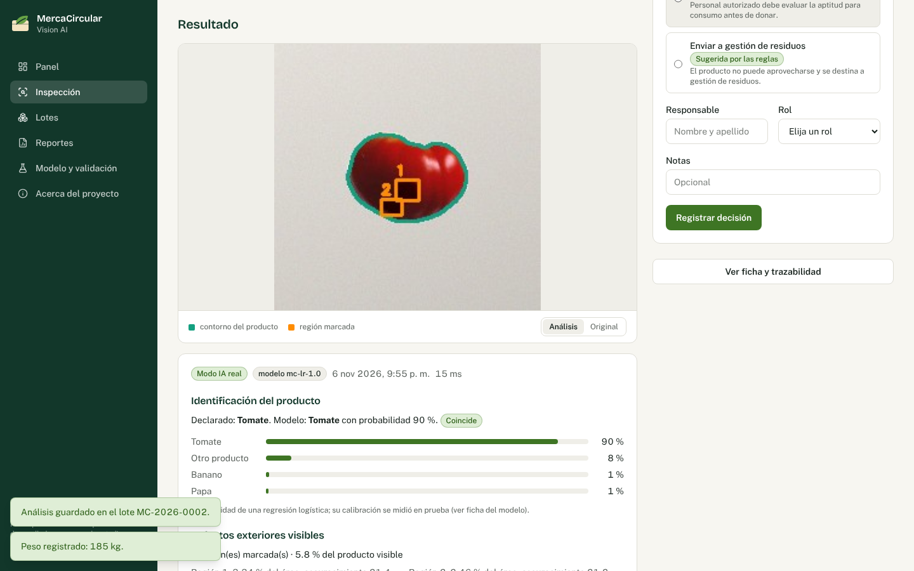
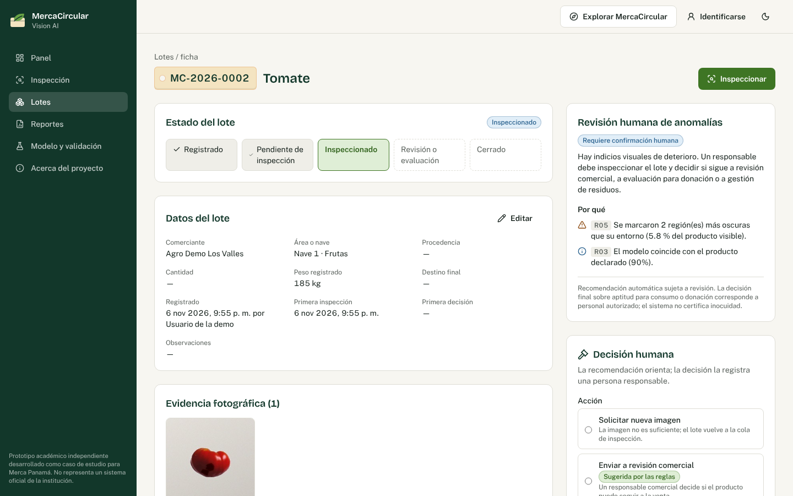
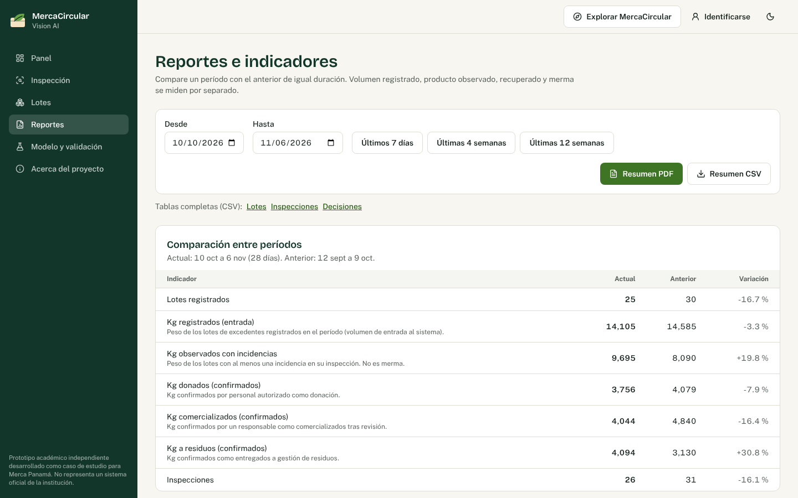
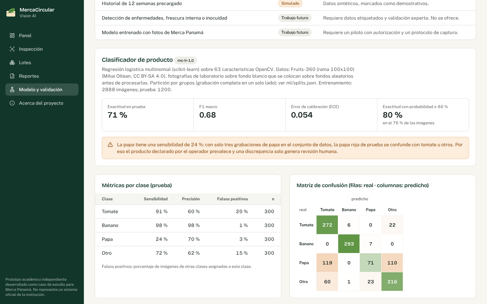
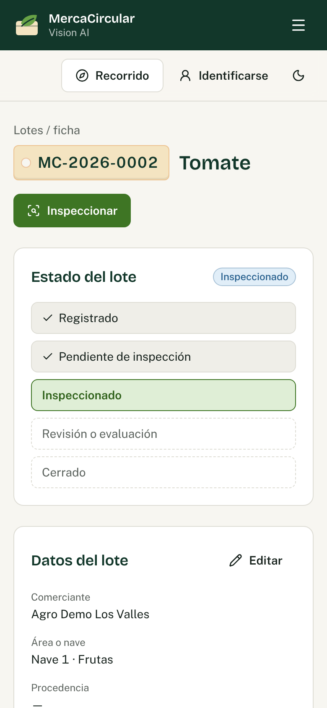
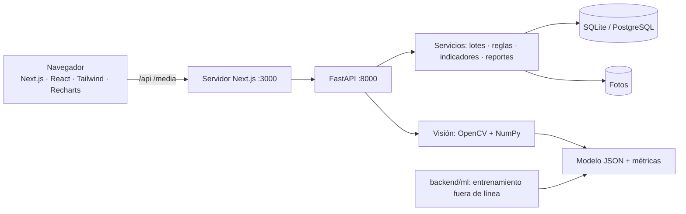

# MercaCircular Vision AI

**Sistema inteligente para la identificación, análisis y gestión de excedentes agrícolas mediante visión artificial.**
Prototipo académico con un caso de estudio en el mercado mayorista Merca Panamá.

> *Prototipo académico independiente desarrollado como caso de estudio para Merca Panamá. No representa un sistema oficial de la institución.*
> No existe relación institucional, contrato ni autorización de Merca Panamá. Comerciantes, personas y lotes precargados son ficticios.



**Problema → Captura de datos → Visión artificial → Análisis → Decisión humana → Trazabilidad → Indicadores**

**Demo en línea:** se publica en Render con el plan gratuito; ver [docs/despliegue-nube.md](docs/despliegue-nube.md).
Si el servicio estaba dormido, la primera carga tarda cerca de un minuto, y los datos vuelven al estado demostrativo al reiniciarse.

---

## Contenido

1. [El problema y el caso de estudio](#1-el-problema-y-el-caso-de-estudio)
2. [Objetivos](#2-objetivos)
3. [Qué hace la demo](#3-qué-hace-la-demo)
4. [Implementado, simulado y futuro](#4-implementado-simulado-y-futuro)
5. [Visión artificial: resultados y limitaciones](#5-visión-artificial-resultados-y-limitaciones)
6. [Arquitectura y tecnologías](#6-arquitectura-y-tecnologías)
7. [Instalación y ejecución (Windows)](#7-instalación-y-ejecución-windows)
8. [Demostración guiada](#8-demostración-guiada)
9. [Pruebas](#9-pruebas)
10. [Subir a GitHub y desplegar](#10-subir-a-github-y-desplegar)
11. [Trabajo futuro](#11-trabajo-futuro)
12. [Documentación y licencias](#12-documentación-y-licencias)

---

## 1. El problema y el caso de estudio

En un mercado mayorista se reciben, almacenan y venden grandes volúmenes de frutas y vegetales. En ese
recorrido, una parte del producto pierde valor comercial, sufre daños superficiales o no encuentra
comprador. Hay que decidir qué hacer con ella: volver a ofrecerla, evaluarla para **donación** o enviarla
a **gestión de residuos**. Esa decisión depende de una inspección, y su documentación y trazabilidad
son una oportunidad para la visión artificial y los sistemas de información.

**Merca Panamá**, el mercado mayorista de productos agrícolas de la República de Panamá, se usa como
caso de estudio por sus necesidades de gestión de residuos orgánicos, aprovechamiento de excedentes y
trazabilidad. El proyecto **no supone** que el mercado carezca de sistemas ni que sus procesos sean
manuales: plantea una mejora posible que tendría que evaluarse en un piloto.

**Justificación tecnológica.** La foto de un lote, tomada con un teléfono, puede documentar su estado,
alertar de indicios visibles de deterioro y dejar evidencia. Pero la aptitud de un alimento para consumo
no puede certificarla un modelo: por eso el sistema **recomienda** con reglas transparentes y siempre
exige que una persona autorizada **decida**.

## 2. Objetivos

**General.** Desarrollar un prototipo académico de plataforma web que integre visión artificial y gestión
de datos para apoyar la identificación, clasificación y trazabilidad de excedentes agrícolas, con Merca
Panamá como caso de estudio.

**Específicos.**

1. Módulo de captura y procesamiento de imágenes (cámara web, cámara del teléfono o archivo). ✅
2. Modelo de visión para reconocer productos y detectar defectos exteriores visibles. ✅ *(con limitaciones medidas, ver §5)*
3. Registro y seguimiento de lotes. ✅
4. Motor de recomendaciones basado en el análisis visual y reglas de negocio. ✅
5. Dashboard de mermas, incidencias, recuperación y trazabilidad. ✅
6. Validación mediante escenarios de prueba documentados. ✅ *(pytest, vitest y recorrido en navegador; ver §9)*

## 3. Qué hace la demo

| Módulo | Funcionalidad |
|---|---|
| **A. Dashboard** | Lotes, kg registrados, pendientes, en evaluación para donación, en gestión de residuos, producto observado; lotes por estado; tendencia semanal; distribución por producto; incidencias; destinos confirmados; historial de análisis. Todo se calcula desde la base de datos. |
| **B. Inspección** | Elegir lote y producto · cámara (webcam o teléfono) · archivo · imágenes de ejemplo · **modo IA real** o **modo demostrativo** · resultado con identificación y probabilidad, defectos con regiones, calidad de imagen, observaciones y limitaciones. |
| **C. Lotes** | Alta, búsqueda, filtros (estado, producto, área, demo/propios), paginación, edición controlada (con responsable y motivo), fotos, resultados y estado. |
| **D. Decisiones** | Reglas R01–R09 con sus razones; acciones sugeridas; registro de quién decide, con qué rol, kg y notas; la donación exige rol autorizado y confirmación explícita. |
| **E. Trazabilidad** | Ficha del lote con recorrido de estados, línea de tiempo con responsables, evidencia fotográfica, peso, destino final y **QR** que abre la ficha (etiqueta imprimible). |
| **F. Reportes** | Período vs. período anterior: kg por producto, incidencias por categoría, lotes pendientes, destinos, recuperado confirmado, tiempos de procesamiento. **CSV y PDF**. |
| **Extras** | Recorrido guiado *Explorar MercaCircular*, modo claro/oscuro, diseño responsive, ficha del modelo con sus métricas, restablecimiento de la demo. |

| Inspección en modo IA real | Ficha y trazabilidad del lote |
|---|---|
|  |  |

| Reportes | Modelo y validación | Móvil |
|---|---|---|
|  |  |  |

**Indicadores sin mezclar conceptos.** *Volumen registrado* (entrada), *producto observado* (lotes con
incidencias), *recuperado* (kg confirmados por una persona como donación o comercialización) y *merma
confirmada* (kg confirmados a residuos) se miden por separado.

## 4. Implementado, simulado y futuro

| Componente | Estado |
|---|---|
| Validación de calidad de imagen (resolución, cobertura, encuadre, exposición, nitidez) | ✅ Implementado |
| Segmentación producto/fondo (OpenCV) | ✅ Implementado |
| Identificación tomate / banano / papa / otro (modelo entrenado) | ✅ Implementado · papa poco fiable |
| Detección de manchas oscuras con regiones reales | ✅ Implementado · heurístico, validado con manchas sintéticas |
| Motor de reglas, estados, roles, decisiones, trazabilidad, QR, reportes CSV/PDF | ✅ Implementado |
| **Modo demostrativo** (4 escenarios predefinidos) | 🟡 Simulado, siempre rotulado, sin regiones ni probabilidades |
| Historial de 12 semanas precargado (80 lotes) | 🟡 Sintético, marcado como demostrativo |
| Detección de enfermedades, frescura interna o inocuidad | ⏳ Futuro (no se ofrece) |
| Modelo entrenado con fotos reales del mercado | ⏳ Futuro (requiere piloto autorizado) |
| Autenticación de usuarios | ⏳ Futuro (el responsable se escribe en cada acción) |

## 5. Visión artificial: resultados y limitaciones

**Pipeline (modo IA real):** reducción a ≤ 800 px → segmentación por color de fondo (k-means + Otsu +
morfología) → validación de calidad → 63 características de color, forma y textura → **regresión
logística multinomial** (entrenada con scikit-learn, exportada a JSON, inferencia en NumPy) → detector de
manchas (modelo de sombreado polinómico + contraste local) → imagen anotada. ≈ 20–90 ms por imagen en CPU.

**Datos:** [Fruits-360](https://github.com/fruits-360) (CC BY-SA 4.0). Partición **por grabación**
(ninguna grabación está en entrenamiento y prueba a la vez) para evitar fuga entre fotogramas casi
idénticos; regularización elegida con validación *leave-one-group-out*; prueba evaluada una sola vez.

| Prueba (grupos nunca vistos) | Valor |
|---|---|
| Exactitud / F1 macro | 71 % / 0.68 |
| Sensibilidad tomate · banano · papa · otro | 91 % · 98 % · **24 %** · 72 % |
| Falsos positivos tomate | 20 % |
| Calibración (ECE) | 0.055 |
| Detector de manchas (sintético), manchas marcadas: tomate · banano · papa | 71 % · 92 % · 92 % |
| Falsos positivos del detector en imágenes limpias: tomate · banano · papa | 16 % · 53 % · 4 % |

**Lo que esto significa:** el banano se reconoce bien, el tomate con bastantes falsos positivos y la
**papa no es fiable** (solo hay tres grabaciones de papa). Por eso el producto declarado por el operador
prevalece, y las discrepancias solo generan revisión humana. El detector de manchas también marca
manchas naturales (maduración del banano) y **no se validó con defectos reales**. Nada en el sistema
certifica inocuidad.

Detalle completo (matriz de confusión, comparación con SVM, red neuronal, bosque aleatorio y boosting,
exactitud por grupo, umbrales de nitidez): [`docs/dataset-y-validacion.md`](docs/dataset-y-validacion.md)
y la página **Modelo y validación** de la app.

**¿Por qué no una red neuronal profunda?** Para que corra en cualquier laptop con Windows sin GPU ni
descargas grandes; porque ImageNet no tiene clases de tomate ni papa; y porque en el entorno de
desarrollo no fue posible descargar pesos preentrenados para validarlos honestamente. La arquitectura
permite cambiar el clasificador (ver *Trabajo futuro*).

## 6. Arquitectura y tecnologías



| Capa | Tecnologías |
|---|---|
| Frontend | Next.js 15, React 19, TypeScript, Tailwind CSS 3, Recharts 3, lucide-react, qrcode |
| Backend | Python 3.11–3.13, FastAPI, SQLAlchemy 2, Pydantic 2, fpdf2 |
| Visión | OpenCV 4, NumPy; scikit-learn solo para entrenar |
| Datos | SQLite (por defecto), preparado para PostgreSQL |
| Pruebas | pytest + httpx, vitest, verificación en navegador con Playwright |

Más: [arquitectura y decisiones](docs/arquitectura.md) · [modelo de datos](docs/modelo-de-datos.md) ·
[API](docs/api.md) (y `http://127.0.0.1:8000/docs`) · [requisitos y casos de uso](docs/requisitos-y-casos-de-uso.md).

## 7. Instalación y ejecución (Windows)

**Requisitos:** Python 3.11–3.13, Node.js 20 o 22, Git. Guía detallada y solución de problemas:
[`docs/guia-windows.md`](docs/guia-windows.md).

```powershell
# 1. Instalar dependencias (crea backend\.venv y frontend\node_modules)
powershell -ExecutionPolicy Bypass -File scripts\setup.ps1

# 2. Iniciar backend + frontend y abrir el navegador en http://localhost:3000
powershell -ExecutionPolicy Bypass -File scripts\start.ps1
```

| Script | Para qué |
|---|---|
| `scripts\start.ps1 [-Prod] [-Lan]` | Inicia todo. `-Prod`: compilado (más fluido). `-Lan`: accesible desde el teléfono |
| `scripts\start-backend.ps1` / `start-frontend.ps1` | Cada parte por separado |
| `scripts\test.ps1` | Todas las pruebas |
| `scripts\reset-demo.ps1` | Borra la base local y las fotos (backend detenido) |
| `scripts\train-model.ps1` | Descarga el dataset y reentrena (opcional) |

Linux, macOS o WSL: `scripts/setup.sh` y `scripts/start.sh`.

**Manual, sin scripts:**

```powershell
py -3.12 -m venv backend\.venv
backend\.venv\Scripts\pip install -r requirements-dev.txt
cd backend;  .venv\Scripts\python -m uvicorn app.main:app --port 8000   # terminal 1
cd frontend; npm ci; npm run dev                                     # terminal 2
```

**Configuración:** opcional, en `.env` (ver [`.env.example`](.env.example)). Sin `.env` todo funciona
con valores por defecto. **Pesos del modelo:** ya incluidos en `backend/models` (son derivados de
Fruits-360, CC BY-SA 4.0); para regenerarlos, `scripts\train-model.ps1`.

## 8. Demostración guiada

Botón **Explorar MercaCircular** (arriba a la derecha). Diez pasos que usan las funciones reales, con
*Atrás*, *Siguiente*, *Omitir* y *Finalizar*:

1. Panel → 2. registrar un lote de tomates → 3. cargar una imagen de ejemplo → 4. ejecutar el análisis →
5. ver las anomalías → 6. registrar el peso → 7. leer la recomendación y sus razones → 8. confirmar la
decisión humana → 9. ver el estado actualizado → 10. trazabilidad, QR e indicadores actualizados.

Guion sugerido para presentar (5 min): panel → recorrido guiado → en la ficha, intentar **registrar la
donación con el rol «Coordinador(a) comercial»** (el sistema lo rechaza) y luego con «Inspector(a) de
calidad» marcando la confirmación → *Modelo y validación* para discutir resultados y limitaciones.

## 9. Pruebas

```powershell
powershell -ExecutionPolicy Bypass -File scripts\test.ps1
```

- **Backend (pytest, 32 pruebas):** segmentación, calidad, detector de manchas (localiza manchas
  conocidas e ignora el sombreado), clasificador sobre imágenes de prueba, reglas R01–R09, máquina de
  estados, flujo completo por API, roles y confirmación de donación, validaciones de error, filtros,
  CSV/PDF, persistencia tras reiniciar y restablecimiento.
- **Frontend (vitest + TypeScript estricto):** formato es-PA y definición del recorrido guiado.
- **Navegador (Playwright, ejecutado durante el desarrollo):** recorrido guiado completo, rechazo de
  rol no autorizado, cámara con dispositivo simulado, descarga de PDF, búsqueda, tema oscuro y ausencia
  de desplazamiento horizontal a 390 px.

Resultados y alcance de cada prueba: [`docs/pruebas.md`](docs/pruebas.md).

## 10. Subir a GitHub y desplegar

Repositorio previsto: **`charrixxz23/mercacircular-vision-ai`**.

```powershell
git init -b main
git add .
git commit -m "MercaCircular Vision AI: prototipo académico inicial"
git remote add origin https://github.com/charrixxz23/mercacircular-vision-ai.git
git push -u origin main
```

**Demo en la nube:** el repositorio incluye `Dockerfile`, `docker/start.sh` y `render.yaml` para
desplegar API e interfaz en un solo contenedor en **Render** (plan gratuito): *New → Blueprint →*
elegir el repositorio. Pasos, límites del plan gratuito y privacidad: [docs/despliegue-nube.md](docs/despliegue-nube.md).
La integración continua (`.github/workflows/ci.yml`) ejecuta las pruebas y construye la imagen en cada push.

Antes de usarlo con datos reales hacen falta autenticación, base de datos persistente (PostgreSQL)
y una política de retención de fotos.

## 11. Trabajo futuro

1. Piloto autorizado con protocolo de captura y un conjunto etiquetado del mercado (producto + estado + regiones).
2. Modelo de detección de defectos supervisado (p. ej. una CNN ligera exportada a ONNX) validado con ese conjunto.
3. Más productos (plátano, cebolla, zanahoria…) agregando clases al modelo y filas a `products`.
4. Autenticación, roles reales y firma de decisiones; migraciones con Alembic; PostgreSQL.
5. Integración con básculas y con el registro de destinatarios de donaciones.
6. Indicadores de impacto (kg desviados de residuos, CO₂ equivalente) con metodologías reconocidas.

## 12. Documentación y licencias

| Documento | Contenido |
|---|---|
| [docs/arquitectura.md](docs/arquitectura.md) | Diagramas de componentes y de flujo, decisiones de arquitectura, estructura de carpetas |
| [docs/modelo-de-datos.md](docs/modelo-de-datos.md) | Diagrama entidad-relación y notas de diseño |
| [docs/api.md](docs/api.md) | Rutas, cuerpos, respuestas, reglas de transición |
| [docs/dataset-y-validacion.md](docs/dataset-y-validacion.md) | Datos, partición, métricas, matriz de confusión, limitaciones, reproducción |
| [docs/requisitos-y-casos-de-uso.md](docs/requisitos-y-casos-de-uso.md) | Requisitos funcionales/no funcionales y casos de uso |
| [docs/pruebas.md](docs/pruebas.md) | Estrategia y resultados de pruebas |
| [docs/guia-windows.md](docs/guia-windows.md) | Paso a paso en Windows y solución de problemas |
| [docs/despliegue-nube.md](docs/despliegue-nube.md) | Demo pública en Render con Docker |

**Licencias.** Código: **MIT**. Imágenes de ejemplo y pesos del modelo: derivados de Fruits-360
(Mihai Oltean), **CC BY-SA 4.0**. Detalle de dependencias y atribuciones en [LICENSE](LICENSE) y
[demo-data/ATTRIBUTION.md](demo-data/ATTRIBUTION.md). La identidad visual (nombre, isotipo, colores) es
original y no usa logotipos de Merca Panamá.
