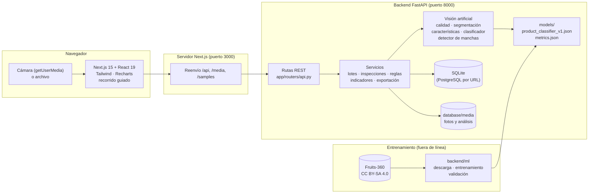
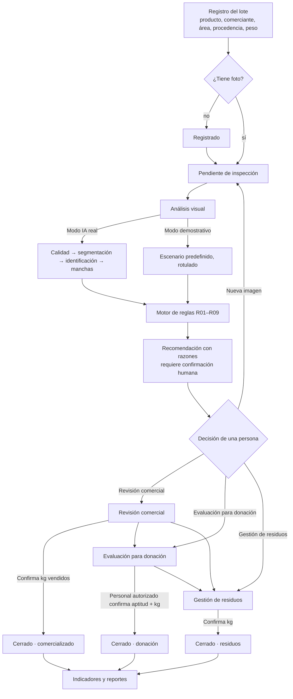
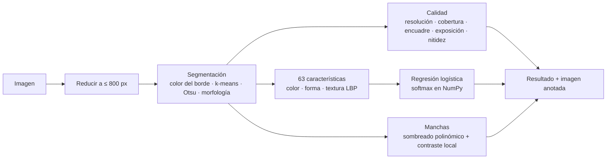

# Arquitectura

## Vista general



- **Frontend**: interfaz de una sola aplicación con barra lateral. Solo llama rutas relativas; el
  servidor de Next.js las reenvía al backend (sin CORS, y el QR funciona con la IP desde la que se abra).
- **Backend**: FastAPI con SQLAlchemy 2. Los servicios no dependen de HTTP y se prueban directamente.
- **Visión**: OpenCV + NumPy. El clasificador se entrena con scikit-learn, pero se **exporta a JSON** y la
  inferencia es una multiplicación de matrices en NumPy: no hay archivos *pickle* ni dependencia de la
  versión de scikit-learn en producción.
- **Entrenamiento separado de la inferencia**: `backend/ml/` (descarga, entrenamiento, validación) no se
  importa desde la API.

## Flujo del proceso



Cada flecha deja un evento en `lot_events` con fecha, responsable y datos (trazabilidad).

## Pipeline de visión (modo IA real)



## Decisiones de arquitectura

| # | Decisión | Alternativas | Motivo |
|---|---|---|---|
| D1 | **FastAPI + Next.js** (stack sugerido) | Monolito Django; solo Streamlit | Separa API documentada (OpenAPI en `/docs`) de una interfaz empresarial; ambos corren en Windows sin servicios pagos. |
| D2 | **Visión clásica (OpenCV) + regresión logística**, no una red profunda | CNN preentrenada (MobileNet/ResNet), CLIP | Corre en CPU en cualquier laptop con Windows, sin GPU ni descargas de cientos de MB; es interpretable y se entrena en ~1 min. En este entorno de desarrollo no se pudo descargar pesos preentrenados (PyTorch/Hugging Face bloqueados), así que una CNN no habría podido validarse honestamente. Además, ImageNet no tiene clases de tomate ni de papa. |
| D3 | **Modelo exportado a JSON** | `joblib`/`pickle` | Evita cargar código arbitrario y la incompatibilidad entre versiones de scikit-learn. |
| D4 | **Detector de manchas heurístico** | Segmentación supervisada de defectos | No hay un conjunto de defectos etiquetado disponible; la heurística sí localiza regiones reales y se validó con manchas sintéticas (documentado como tal). |
| D5 | **Modo demostrativo separado y rotulado** | Simular resultados de IA | Requisito de integridad: los escenarios nunca dibujan regiones ni muestran probabilidades. |
| D6 | **Reglas explícitas (R01–R09) + decisión humana obligatoria** | Que el modelo decida el destino | La aptitud para consumo o donación no puede certificarla una IA; las reglas son auditables. |
| D7 | **SQLite con SQLAlchemy** | PostgreSQL desde el inicio | Cero instalación para la demo; PostgreSQL se activa con `DATABASE_URL`. |
| D8 | **Imágenes re-codificadas a JPEG al subir** | Guardar el archivo original | Normaliza el formato, limita tamaño y elimina metadatos EXIF (p. ej., ubicación GPS). |
| D9 | **Reenvío de rutas en Next.js** | CORS y URL absoluta del backend | El QR y la app funcionan desde la IP de la red local sin reconfigurar. |
| D10 | **Datos demostrativos reproducidos con la lógica real** | Insertar filas directamente | Garantiza que los datos sembrados respetan la máquina de estados y la trazabilidad. |

## Estructura de carpetas

```
MercaCircular-Vision-AI/
├── backend/
│   ├── app/
│   │   ├── main.py            creación de la app, arranque, archivos estáticos
│   │   ├── config.py          variables de entorno
│   │   ├── db.py, models.py   SQLAlchemy (9 tablas)
│   │   ├── schemas.py         validación de entrada (Pydantic)
│   │   ├── serializers.py     respuestas JSON
│   │   ├── routers/api.py     rutas REST
│   │   ├── services/          lotes, inspecciones, reglas, estados, indicadores, exportación, datos demo
│   │   └── vision/            calidad, segmentación, características, clasificador, manchas, pipeline
│   ├── ml/                    descarga del dataset, partición, entrenamiento, validación, imágenes demo
│   ├── models/                modelo exportado (JSON) y métricas
│   └── tests/                 pytest: visión, reglas, API
├── frontend/
│   ├── app/                   páginas: panel, inspección, lotes, ficha, reportes, modelo, acerca
│   ├── components/            interfaz, gráficos, análisis, decisión, recorrido guiado
│   ├── lib/                   cliente API, tipos, formato, pasos del recorrido
│   └── tests/                 vitest
├── database/                  SQLite y fotos (generados), esquema de referencia
├── demo-data/                 datos sintéticos, escenarios, imágenes de ejemplo
├── docs/                      esta documentación
└── scripts/                   instalación, ejecución y pruebas (PowerShell y bash)
```
