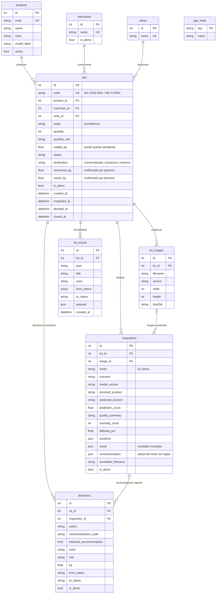

# Modelo de datos

Definido en `backend/app/models.py` (SQLAlchemy 2). Esquema SQL de referencia: `database/schema.sql`.
Fechas en UTC; la interfaz las muestra en hora de Panamá.

## Notas de diseño

- **Inmutabilidad práctica de la evidencia.** Las inspecciones y decisiones no se editan ni borran
  desde la API; los cambios del lote se registran como eventos con el valor anterior y el nuevo.
- **Recomendación guardada tal como se emitió** (`inspections.recommendation`). La ficha solo oculta
  la razón R07 si el peso se registró después.
- **Separación de magnitudes.** `weight_kg` (entrada), `recovered_kg` y `waste_kg` (confirmados por
  una persona) son columnas distintas; los indicadores nunca derivan uno de otro.
- **Datos demostrativos** marcados con `is_demo` en lotes, inspecciones, decisiones y comerciantes.
- **Productos ampliables.** Agregar un producto es una fila en `products`. Si su `model_label` no es
  una clase del modelo, la identificación se muestra solo como orientativa y no genera la regla R02.
